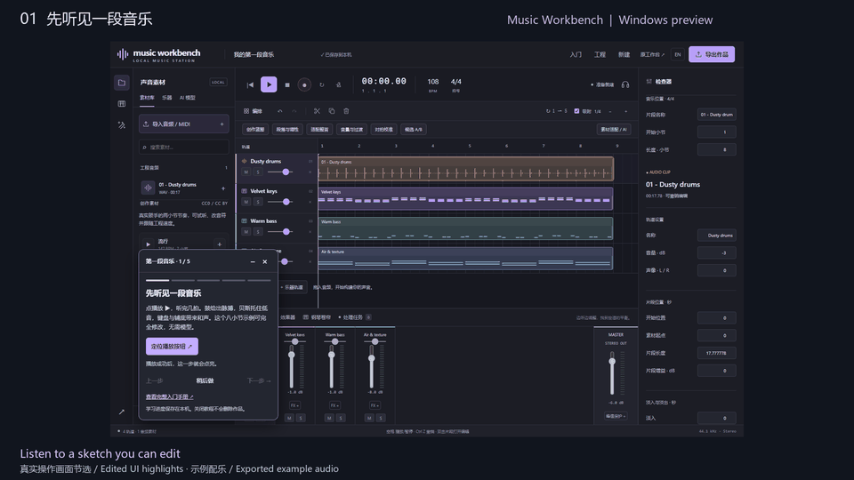

# Music Workbench

[English](README.en.md) · 中文

本地运行的开源音乐创作工作台。用采样乐器、MIDI、多轨编排、录音和混音制作音乐，也可以把本地 AI 生成、分离和转录的素材加入作品。

[**下载 Windows 安装器**](https://github.com/Hydr0g3ngz/music-workbench/releases/download/v0.2.0.dev21/Music-Workbench-0.2.0.dev21-Setup-x64.exe) · [入门教程](docs/first-sketch.md) · [文档目录](docs/README.md)

Windows 10 22H2 / 11 x64 · 中文 / English · 开发预览版，安装器未签名

**dev21 开发预览版**：从 AI 钢琴短句到可编辑音符、成组编排、总线混音和便携工程。新增 [Transkun 钢琴转录](docs/piano-notes.md)、[音符声部整理与批量淡变](docs/note-editing.md)，并修复任务按钮刷新、保存与选中状态问题。[版本说明](docs/releases/v0.2.0.dev21.md) · [《雨后的街灯》完整案例](docs/creations/after-the-rain.md)。



## 制作第一段音乐

1. 下载并安装，从桌面或开始菜单打开 **Music Workbench**。基础运行环境已包含，无需安装 Python。
2. 首页选择 **跟着做出第一段音乐**，打开独立的八小节示例。
3. 跟着软件内的五步提示试听音轨、改一个音符、调整混音，再导出 WAV。
4. 导出 `.mwb` 保留可编辑工程及音频，下次可以恢复后继续制作。

跟练约需 5–10 分钟，无需账号、AI 模型或专业显卡。关闭后可从顶部 **入门** 继续；软件内提供完整离线手册。

[安装与升级](docs/windows-install.md) · [教程详细步骤](docs/first-sketch.md) · [可选示例工程](docs/examples.md)


## 可以做什么

| 想做的事 | 可用功能 | 使用指南 |
| --- | --- | --- |
| 从零写一段音乐 | 采样钢琴、马林巴、鼓组与合成音色；八种鼓点；MIDI 导入、音符拖动、多选、量化、力度编辑 | [乐器与 MIDI](docs/creation-library.md) |
| 整理成完整编排 | 多轨剪辑、分组复制、段落标记、跨轨范围复制、小节定位、循环与节拍器、撤销/重做 | [工作台](docs/create-preview.md) · [循环](docs/timing.md) |
| 录下自己的声音 | 选择输入、查看电平、录音、试听后从播放头加入新轨 | [本地录音](docs/recording.md) |
| 打磨混音与过渡 | 音量/声像、总线与发送、EQ、压缩、混响、音量曲线、批量淡变 | [混音](docs/mixing.md) · [音量与过渡](docs/volume-and-repaint.md) |
| 用 AI 制作素材 | ACE-Step 文字生成、参考变奏与局部重绘；RoFormer/Demucs 分轨；Basic Pitch 多音、Transkun 钢琴与 CREPE 单旋律转 MIDI | [模型与安装](docs/models.md) |
| 让素材融入作品 | 速度/调性估计、参考拍校准、独立变速变调、等响度候选 A/B | [素材适配](docs/material-fitting.md) |
| 保存与分享 | WAV、MIDI、素材署名、含音频的 `.mwb` 便携工程 | [工程与导出](docs/create-preview.md#保存与导出) |

## 本地 AI 是可选项

首页 **AI 自动配置** 可安装 ACE-Step 的独立运行环境、下载并校验模型。该配置需要兼容的 **NVIDIA 显卡、至少 8 GB 显存和 35 GB 可用空间**；首次联网下载约 8–12 GB。基础创作可先离线使用。

AI 工具管理还提供七个独立处理工具包，按需安装并执行真实离线验证。所有结果先成为候选，试听后再加入工程；采用支持撤销。模型耗时、显存与效果取决于硬件、输入和配置。[支持状态与要求](docs/models.md) · [AI 制作流程](docs/ai-production-workflow.md)

## 版本范围

当前版本支持固定 4/4 拍、最多 32 轨、8 条总线和 10 分钟工程。VST、效果参数自动化、同步叠录、延迟补偿和工作台全流程 Agent 操作尚未提供。安装器没有自动更新器；更新前请保存工程并关闭软件。[dev21 发布说明与校验](https://github.com/Hydr0g3ngz/music-workbench/releases/tag/v0.2.0.dev21)

## 从源码运行与参与贡献

Python 3.11 / 3.12：

```sh
python -m venv .venv
# Windows: .venv/Scripts/activate
# Linux/macOS: source .venv/bin/activate
python -m pip install -e ".[workstation]"
music-workbench
```

源码默认将工程保存在 `outputs/workbench`，服务从端口 8920 起选择空闲端口。Windows 安装版作品位于 `%LOCALAPPDATA%\MusicWorkbench\Projects`，可通过 `.mwb` 在工作区之间转移。

[贡献指南](CONTRIBUTING.zh-CN.md) · [路线图](docs/workbench-roadmap.md) · [报告问题](https://github.com/Hydr0g3ngz/music-workbench/issues) · [更新记录](CHANGELOG.md)

需要歌词、旋律、和弦与节拍的整曲分析，请访问独立项目 [Music Studio](https://github.com/Hydr0g3ngz/music-studio)。

## 许可

本项目代码采用 [MIT](LICENSE)。模型权重、声库和素材分别适用其来源许可；模型权重单独下载。内置采样与鼓点的署名可随作品导出，详见 [第三方说明](THIRD_PARTY_NOTICES.md)。
