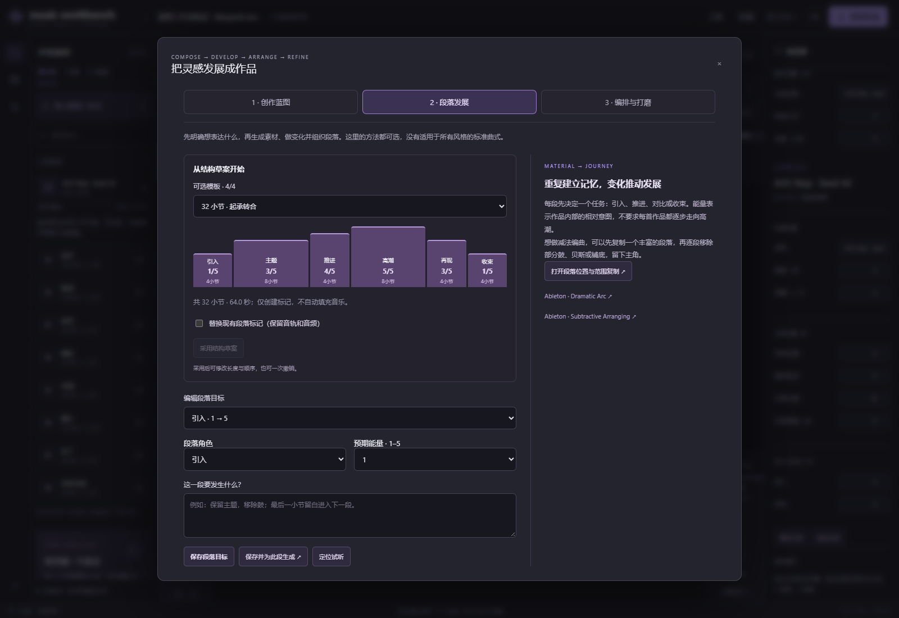
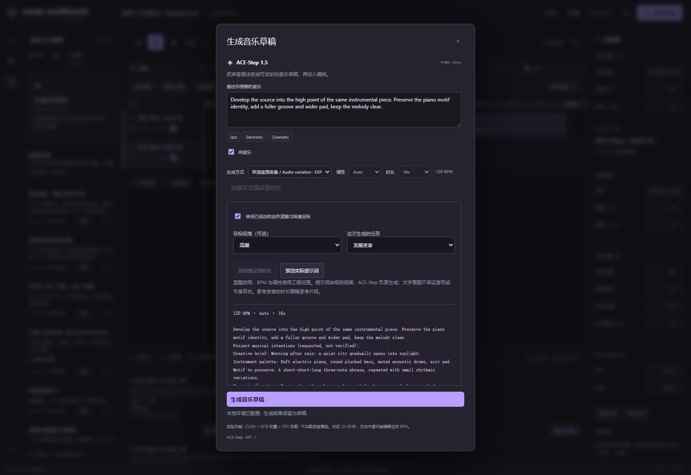
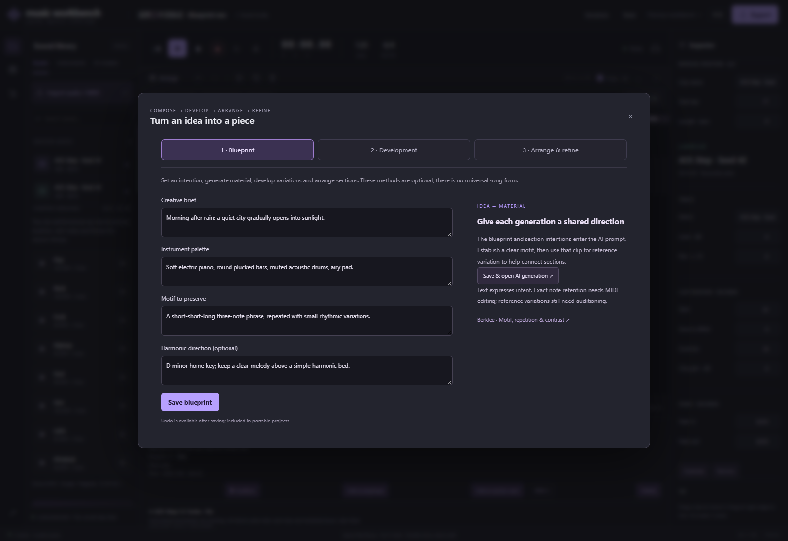

# 创作蓝图工作流验证 / Blueprint workflow verification

2026-10-16 · 0.2.0.dev9 · Windows · RTX 4070 Laptop GPU

独立测试工程 `bc5c7b3bb2e743ad`，未修改前两首作品或用户原有工程。
这是包含留白的功能样本，不作为一首完成作品发布，也没有听感质量评级。

Independent fixture; earlier pieces and existing user projects were preserved.
This partially filled arrangement verifies operations, not finished music or listening quality.

## 操作记录 / Steps

1. 浏览器创建工程，120 BPM；填写“雨后清晨城市从安静走向明亮”的创作意图。
   Create at 120 BPM; describe a quiet city opening into morning light.
2. 保存电钢琴、拨弦贝斯、克制鼓与铺底的音色，以及短短长三音动机；采用 32 小节结构草案。
   Save palette and short–short–long motif; apply the 32-bar sketch.
3. 为主题填写“清楚陈述动机、保留发展空间”，按段落请求 16 秒；在界面预览实际提示词后生成。
   Write the theme intention, request its 16 s duration and preview the compiled prompt.
4. 在主题起点第 5 小节（8 秒）采用；实际操作撤销、重做。
   Adopt at bar 5 / 8 s, undo and redo.
5. 保留同一蓝图，用主题音频做参考；选择“发展变奏”，指定高潮的更丰富节奏与铺底，预览后请求 16 秒参考变奏。
   Reference the theme with the same blueprint; choose development and a fuller peak intention, preview, then generate.
6. 在第 17 小节（32 秒）采用。布局检查正确显示两段 100% 覆盖、其余段落未填充。
   Adopt at bar 17 / 32 s. Review shows both filled sections at 100% and the remaining sections empty.
7. 对选中音频加 15 ms 边缘淡变；撤销后两端为 0，重做后均为 0.015 秒。
   Apply edge fades; undo restores zero and redo restores 0.015 s on both ends.
8. 导出 `.mwb` 与 48 秒 WAV，新目录恢复后工程内容相同，WAV 字节相同。
   Export pack and 48 s WAV; fresh restore retains identical content and WAV bytes.

所有编辑、生成提交和采用通过实际浏览器完成；API/本地脚本仅用于取证、导出、恢复验证。
Edits, submissions and adoption used the browser. API/scripts inspected evidence and verified export/restore.

## 实际模型运行 / Real inference

| 任务 / Task | 模式 / Mode | 加载 / Load | 生成 / Generation | 合计 / Total | Torch 已分配显存峰值 / Allocated VRAM peak |
| --- | --- | --- | --- | --- | --- |
| `449610eab58e4843` | 文本主题 / Text theme | 37.312 s | 10.954 s | 48.266 s | 3170.1 MiB |
| `bdca8e8c4c674d91` | 参考发展 / Reference development | 44.015 s | 15.485 s | 59.500 s | 3346.2 MiB |

两次均为独立进程，ACE-Step 1.5 Turbo / INT8 weights / CPU offload / seed 42 / 8 steps / no LM。
系统文件缓存和并行应用未控制，不能据此比较两模式性能。显存数值不是整卡总占用。

Both used separate processes with INT8 weights, CPU offload, seed 42, eight steps and no language model.
File caches and other applications were uncontrolled. These timings are not a comparative benchmark;
Torch allocation is not total GPU use.

验证读取实际 `worker.json`：最终提示词与任务记录一致，上下文逐字段一致；重新计算两个上下文 SHA256 均相符。
Checked real worker input against task metadata and recomputed both context hashes.

测试工程最终 rev15；WAV 为 stereo / 44.1 kHz / PCM24，48 秒，采样峰值约 −7.00 dBFS。
恢复前后 SHA256：`d6fde3f65ef455cac088417e82807283444ed14e00903708038cd30bdc718ba6`。
其中有意留空的区段计入总时长。完整本地证据位于 `outputs/benchmark/blueprint-validation-dev9/`。

Fixture rev15 exports 48 s stereo 44.1 kHz PCM24 with approximately −7 dBFS sample peak.
The hash above matches the fresh restore; intentional unfilled time is included.
Local evidence is under `outputs/benchmark/blueprint-validation-dev9/`.

自动化验证：全套 163 项 Python 测试通过；最终上下文/生成模块的 9 项针对性测试复跑通过；
61 项前端测试、Ruff 与 diff 检查通过。覆盖旧项目默认值、字段边界、历史/工程包、
预览/入队一致、任务不随后续编辑变化、目标时间失效、裁切 MIDI 覆盖与静音/独奏、
淡变边界，以及已有试听不重载回归。

Automation: 163 Python tests, nine focused final reruns, 61 frontend tests, Ruff and diff checks.
Coverage includes compatibility, bounds, history/packs, preview/queue parity, pinned input,
invalidated target timing, visible-note coverage, mute/solo, fade bounds and playback regressions.

## 界面 / Interface

## 尚未证明 / Not established

动机保留、和声符合、速度符合、自然过渡和音乐质量均未在本轮做盲听或真值评估。
两段样本的覆盖统计不推断音频能量。没有自动等响度 A/B、crossfade 或新增语言模型。
小屏布局与零基础用户效率仍需要实际用户验证。

No blind/ground-truth evaluation establishes motif, harmony, tempo, transition or artistic quality.
Coverage does not infer audio energy. Automatic matched-level A/B, crossfades and a new language model
are outside this build. Small-screen and novice efficiency need user evaluation.
