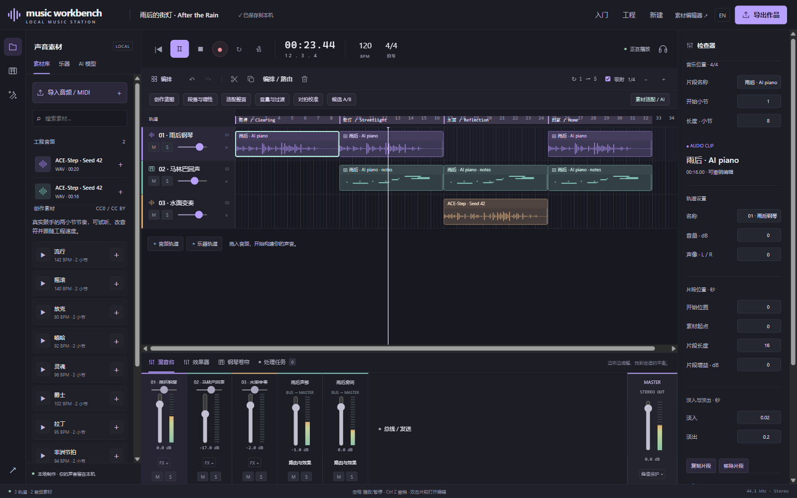

# 雨后的街灯 / After the Rain

[音符整理](../note-editing.md) · [English note tools](../note-editing.en.md) · [验证数据 / Evidence](../../benchmarks/reports/after-the-rain-v1.json)

雨停后的街道，一盏灯映在水面上。作品用独奏钢琴代表街灯，以马林巴的短音回应水滴；中段换成参考变奏，最后让最初的钢琴回来并逐渐收束。这个练习尝试让一段 AI 素材长成有段落分工的作品。

A piano stands for a streetlight after rain; short marimba notes answer like droplets. A reference variation changes the reflection in the middle, then the original piano returns quietly. The goal is to develop one generated phrase into a small piece with a clear form.

## 从空工程完成 / Build from an empty project

1. **写下方向。** 新建空白工程，120 BPM、4/4。给 ACE-Step 的条件是 C major、独奏钢琴、上行短动机、雨后明亮氛围、无鼓无人声。条件不等于结果已被准确验证。Start empty and describe the requested direction; generated harmony and timing still need checking.
2. **生成素材。** ACE-Step 1.5 Turbo，Seed 42、8 步、20 秒。先在任务区试听并采用，再通过检查器裁成 8 小节（16 秒），设置 0.02 秒淡入与 0.2 秒淡出。Generate, audition, adopt and trim through normal UI controls.
3. **变成可编辑的回应。** 运行 Transkun 钢琴转录，试听并把音符加入乐器轨。原始估计 28 个音，使用“整理声部”：MIDI 60–84、最小力度 45、相近起音保留最高音，得到 12 个音；试听后应用，换成马林巴。这是有意删减，不声称纠正了所有误检。Transcribe to editable notes, audition a 12-note upper part and change its instrument. Thinning is an arrangement choice, not an accuracy claim.
4. **组织 32 小节。** 两片段成组，复制到第 9、17、25 小节。验证复制后的撤销与重做。建立“雨停、街灯、水面、归家”四段，并保存创作蓝图。Group and copy to bars 9, 17 and 25, then test undo/redo and save four sections plus the blueprint.
5. **制造对比。** 选原钢琴短句，使用已保存蓝图，生成 16 秒参考变奏，目标为第三段。试听后放到段落起点。移除这一段原钢琴；开头去掉马林巴，使它到第二段才进入。Add a reference variation at the third section and remove the replaced original; leave the opening piano alone.
6. **混音与收束。** 三轨汇入分组总线，轻度压缩；以小发送量进入 100% 湿声共享混响。马林巴约 −17 dB、变奏 −2 dB；结尾两片段批量降低 3 dB、淡出 3 秒。主输出 0 dB。Mix through a group and shared wet reverb; reduce and fade the final pair together.
7. **交付并恢复。** 从界面导出 WAV、MIDI、MWB；在独立工程恢复 MWB，内容一致，再渲染的 WAV 与界面导出逐字节一致。Export through the UI, restore into a separate project and verify identical content and WAV rendering.

上述创作编辑均由普通界面控件完成，浏览器自动化只负责点击和输入。验证脚本读取结果、比较工程和渲染哈希；没有用脚本补做编曲。录制暴露的任务刷新、采用过程保存冲突、错误提示与清除选择异常均在 dev21 修复并回归。

All creative edits used ordinary UI controls, driven by browser automation. Verification scripts read results and compare content/render hashes; they did not finish the arrangement. Bugs found during this exercise were fixed before delivery.

## 输出与限制 / Output and limits

- 32 小节、3 轨、7 片段、2 总线，含尾音 65.7 秒。32 bars, three tracks, seven clips, two buses, 65.7 seconds including the tail.
- 实测 −23.14 LUFS、−7.37 dBTP，无满刻度样本；这是偏安静的钢琴练习，不声称已经过商业母带制作。A quiet piano study, not a claim of commercial mastering.
- 本机 RTX 4070 Laptop 8 GB：主题生成约 65.5 秒，变奏约 64.1 秒（均含模型加载）；转录模型调用约 10.8 秒，完整调用约 18.3 秒。These are single-host measurements, not hardware guarantees.
- ACE-Step 采用 DiT 线性权重 INT8、BF16 其他组件及 CPU 卸载，不加载语言模型。Transkun 为 FP32；音符与力度均是估计。ACE-Step uses partial INT8/offload; Transkun uses FP32. Estimated notes are not score ground truth.
- MIDI 只包含马林巴的可编辑音符；WAV 包含原始生成音频、变奏与效果，MWB 保留完整工程。MIDI contains the editable marimba part, WAV the full mix, MWB the complete project.
- 本例不代表零基础用户已做过可用性试验，也不代表训练数据独立的原创性鉴定。This is a workflow exercise, not an observed beginner usability study or an originality assessment.

模型：[ACE-Step](https://github.com/ACE-Step/ACE-Step-1.5)、[Transkun](https://github.com/Yujia-Yan/Transkun)，均按其许可使用。马林巴采样来自 [VCSL](https://github.com/sgossner/VCSL)，CC0。完整来源随 MWB 与署名文本导出；本例不包含评测数据集的声音。

Models use their respective licenses; marimba samples are VCSL CC0. Full provenance accompanies the project. No benchmark recordings are used in the piece.
