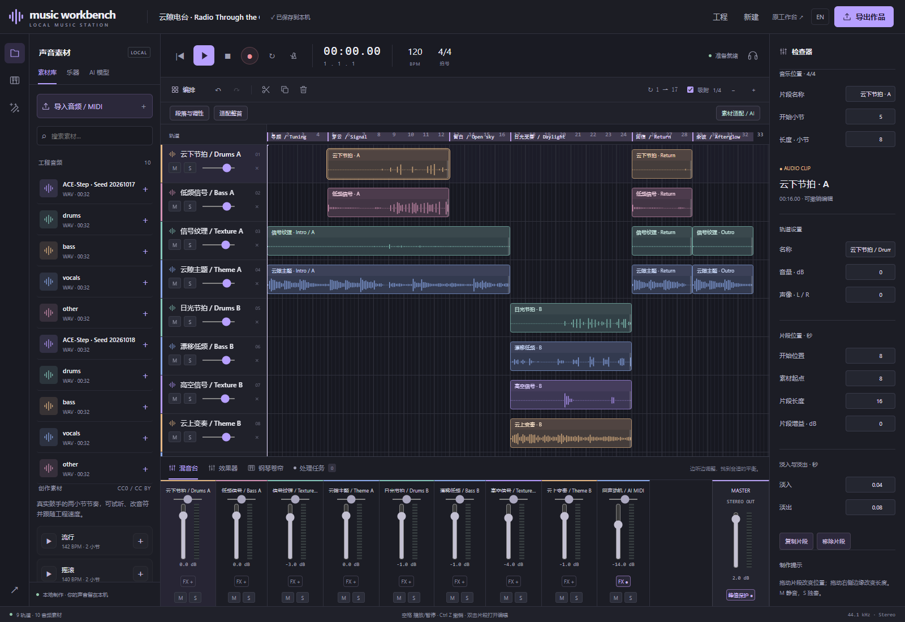

# 云隙电台 / Radio Through the Clouds

2026-10-16 · 64 秒 / seconds · 32 小节 / bars · 工程网格 / project grid 120 BPM · 9 轨 / tracks

## 创作动机 / Intent

把“云层之间时断时续的无线电信号”变成一段器乐草稿：先有模糊纹理，节拍进入，

中段留下空间，随后出现更明亮的变奏，最后让最初的信号回响。

制作方法是以 AI 音频为主体，再拆解、重组，并将部分声部转成可编辑音符。

A radio signal passes through cloud: texture, pulse, open space, brighter variation, then a final reply.

AI-generated audio forms the main material, separated and rearranged with an editable MIDI echo.

## 制作步骤 / Recipe

| 步骤 / Step | 操作与目的 / Action and purpose |
| --- | --- |
| 1 · 定题 / Brief | 新建 120 BPM 工程，生成条件请求 A minor。Create a 120 BPM project and request A minor. |
| 2 · 主题 / Theme | ACE-Step 文本生成 32 秒，seed `20261017`，8 steps；提示 organic downtempo、四音符 pluck、Rhodes、圆润贝斯和 breakbeat、无歌声。Generated a 32 s instrumental theme. |
| 3 · 变奏 / Variation | 选中主题片段，使用参考变奏模式。32 秒、seed `20261018`、参考强度 0.65，要求保留动机、改变日光质感。Keep the motif and ask for a brighter variation. |
| 4 · 拆解 / Separate | 两份生成各跑一次 Demucs htdemucs 四声部分离，成为鼓/贝斯/vocals/other；在编排中将后两者命名为主题/纹理。These are estimated source roles, not verified isolated instruments. |
| 5 · 可编辑动机 / Editable echo | 对原稿贝斯跑 CREPE，采用 36 个单旋律估计音符，整体升两个八度、力度 72，换马林巴，裁出留白段。Check the estimated notes before using them. |
| 6 · 编排 / Arrange | 用界面的小节定位和跨轨段落复制，组成下表 6 段；用裁切和淡变调整连接。Use arrangement tools for adoption, naming, trims, fades and copies. |
| 7 · 混音 / Mix | 纹理轨降低电平、变奏轨微调；马林巴 −14 dB、右偏 0.15、氛围空间。尾段 3 秒淡出，主输出 +2 dB，采样峰值限制 −1 dBFS。Balance by listening and avoid clipping. |
| 8 · 保存 / Save | 导出 WAV 分享声音，导出 `.mwb` 保留音频与可编辑编排；MIDI 只包含转录得到的乐器音符。Export WAV for listening and MWB to keep editing. |
| 段落 / Section | 小节 / Bars, end exclusive | 时间 / Seconds | 声部安排 / Arrangement |
| --- | --- | --- | --- |
| 寻频 / Tuning | 1–5 | 0–8 | 原稿主题与纹理渐入 / Theme and texture fade in |
| 穿云 / Signal | 5–13 | 8–24 | 原稿四声部 / Four parts of A |
| 留白 / Open sky | 13–17 | 24–32 | 主题/纹理与转录马林巴 / Texture, theme and transcribed marimba |
| 日光变奏 / Daylight | 17–25 | 32–48 | 参考变奏四声部 / Four parts of B |
| 回信 / Return | 25–29 | 48–56 | 原稿声部回归 / Return of A |
| 余波 / Afterglow | 29–33 | 56–64 | 主题与纹理淡出 / Theme and texture fade out |

## 使用提示 / Tips

生成的节奏和调性需要试听确认；分离出来的“鼓、贝斯、人声、其他”是模型估计，可能串音。CREPE 只适合单旋律，复杂声部可先尝试分离，再核对音符。

Check generated timing and harmony by ear. Separation roles are estimates and can bleed. CREPE is monophonic; separate complex material before transcribing and edit the resulting notes.

这份配方可以用自己的候选重做，结果不会完全相同。需要可以直接打开的工程，可从其他作品开始练习，见 [示例工程包](../examples.md)。后续可用 [素材适配](../material-fitting.md)、[音量曲线和重绘](../volume-and-repaint.md) 调整连接。

Remake this recipe with your own candidates; outputs will differ. For ready-to-open projects, choose another piece from the [example pack](../examples.md), then explore fitting, curves and repaint.

生成与采样分别遵循 [模型许可](../music-generation.md) 和 [素材库许可](../creation-library.md)。导出署名随作品保留。
