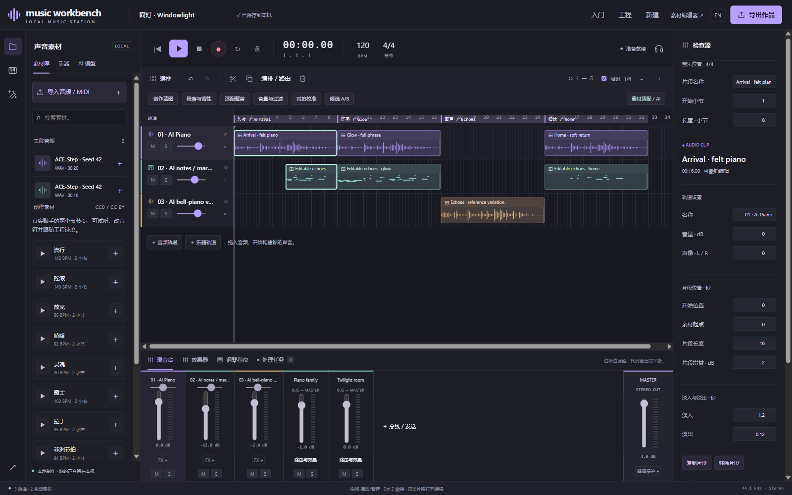

# 窗灯 / Windowlight

[下载示例工程包 / Example projects](../examples.md) · [Basic Pitch](../polyphonic-notes.md) · [分组与路由](../groups-and-routing.md)

黄昏街道的一盏窗灯：稀疏的近距离钢琴，回声渐渐加入，中间换成钟琴般的变奏，最后安静回家。这个器乐练习用留白与音色变化展开，不需要鼓或人声。

Intimate piano, arriving echoes, a bell-like contrast and a quiet return. Space and timbre carry this instrumental sketch.

恢复示例包里的 `Windowlight.mwb` 后，可以直接试听、编辑和导出。先静音马林巴，再恢复它，听相同短句怎样改变质感。

Restore `Windowlight.mwb` to listen, edit and export without installing models. Mute and restore the marimba to hear how its reply changes the phrase.

## 制作思路 / Recipe

1. 建立 120 BPM、4/4 工程，请求 C minor 的稀疏 felt piano。ACE-Step 生成 20 秒，seed 42、8 步；试听后裁成八小节。
2. 用 Basic Pitch 处理这段钢琴，先试听，再把音符加入乐器轨。量化到 1/16，换成马林巴，降低音量并略向右；删减不需要的低音。
3. 钢琴与回声成组，复制到第 9、17、25 小节。副本独立，可以删减某一段的回应。
4. 两轨输出到 Piano family 总线，另建 100% 湿声 Twilight room；从两轨发送少量声音，示例发送量约 −20 / −16 dB。
5. 为第三段生成 16 秒参考变奏。试听后替换这一段原钢琴，结尾恢复原主题并减少回声，最后淡出。

Generate and trim a short piano theme, use Basic Pitch for editable marimba echoes, develop four sections with grouped copies, then use a reference variation and shared reverb to create contrast. Requested tempo/key are starting conditions, not verified guarantees.

| 小节 / Bars | 段落 / Section | 层次 / Texture |
| --- | --- | --- |
| 1–8 | 入夜 / Arrival | 钢琴，后半段加入回声 / Piano, then echoes |
| 9–16 | 灯亮 / Glow | 完整短句与高音回应 / Phrase and upper reply |
| 17–24 | 回声 / Echoes | 参考变奏 / Reference variation |
| 25–32 | 归途 / Home | 原主题、较少回声、较长淡出 / Return, fewer echoes, fade |

## 保存与继续 / Keep editing

工程包含三轨、两条总线，含尾音约 65.7 秒。MIDI 只包含可编辑的马林巴，不包含两条音频钢琴。保存 MWB 保留完整作品；生成新候选时，可先加入新轨比较，再决定替换。

The three-track/two-bus piece is about 65.7 seconds including tails. MIDI includes editable marimba notes, not the piano audio. MWB retains the complete project. Add new candidates to separate tracks before deciding what to replace.
