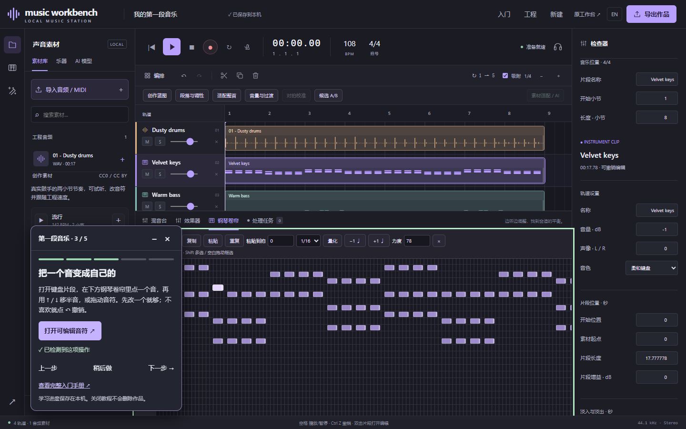

# 第一段音乐 / Your first sketch

[Windows 下载 / Download](https://github.com/Hydr0g3ngz/music-workbench/releases/tag/v0.2.0.dev14)

安装后打开 Music Workbench，首页选择 **跟着做出第一段音乐**。每次新建一份独立的八小节、108 BPM、四轨示例，不覆盖原工程。基础跟练约 5–10 分钟，无需账号、AI 模型或专业显卡。

Open Music Workbench and choose **Make your first musical sketch** on Home. Each click creates a separate eight-bar, 108 BPM, four-track project. Allow 5–10 minutes. No account, AI models or dedicated GPU required.

| 步骤 / Step | 试一试 / Try | 学到什么 / Learn |
| --- | --- | --- |
| 1 · 试听 / Listen | 点播放，听几拍 / Press Play and listen for a few beats | 鼓的脉搏、贝斯的低音、键盘的和声、铺底的空间 / Pulse, low end, harmony and space |
| 2 · 分层 / Layers | 点一条轨道的 M 或 S，再还原 / Mute or solo a track, then restore it | 每一层对整体的作用；导出也遵循开关 / What each layer adds; export respects these switches |
| 3 · 音符 / Notes | 定位可编辑音符，选一个音用 ↑ / ↓ 或拖动 / Open editable notes, select one and use ↑ / ↓ or drag | 时间、音高、时值，及撤销 / Timing, pitch, length and undo |
| 4 · 混音 / Balance | 混音台里把贝斯降低 2–3 dB / Lower the bass by 2–3 dB in Mixer | 用音量给其他声音留空间 / Make room through relative levels |
| 5 · 导出 / Export | 导出 → WAV，再留一份 MWB / Export WAV, then keep an MWB copy | 可播放音频与可编辑工程的区别 / Playable audio versus editable project |

操作成功后会点亮对应步骤。点击“下一步”继续，也可“稍后做”；跳过不会算成已执行。进度只在本机浏览器/软件配置中按工程保留，不随 MWB 转移。关闭、收起和重新跟练均不删除或重置作品。若面板挡住控件，可点减号收起。导出完成指服务器成功生成 WAV，仍需确认下载/保存位置。

The lesson detects actual actions. Continue with Next or explicitly skip; skipped actions are listed separately. Progress stays in this computer's app/browser profile per project and does not travel with MWB. Closing, collapsing or repeating never resets the music. Collapse the panel if it covers a control. A completed export means WAV rendering succeeded; check your download/save location.

工作台顶部 **入门** 可继续学习。完整离线手册在首页和教程面板内打开。已有工程也能打开跟练；空工程需先添加素材与乐器，建议首次使用首页独立示例。

Use **Learn** in the workstation header to resume. The full offline guide opens inside the app from Home or the lesson. Existing projects can use the lesson too; an empty session needs material first, so the separate Home example is recommended.

## 接下来用 AI / Continue with AI

完成后点“探索本地 AI”。已配置 ACE-Step 时进入生成，否则进入图形配置。先尝试 12 秒器乐草稿，试听再采用，结合对拍、裁切和淡化融入作品。自动配置首批覆盖 ACE-Step；需要兼容 NVIDIA 8 GB 显卡、35 GB 空间、首次约 8–12 GB 下载。模型速度与质量因硬件和提示词而异。

Explore local AI after the lesson. A configured ACE-Step runtime opens generation; otherwise open setup. Try a 12-second instrumental, audition before adopting, then fit timing, trim and fade. The first automatic profile covers ACE-Step and requires a compatible NVIDIA GPU with 8 GB VRAM, 35 GB free space and roughly 8–12 GB initial downloads. Speed and quality vary.

[技术验证 / Technical verification](feature-validation.md)。
