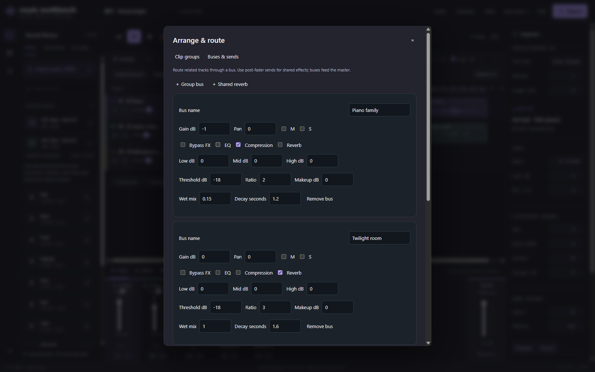

# Clip groups, buses and sends

[中文](groups-and-routing.md) · [Documentation](README.en.md)

Available in dev20 source/local builds. These additions are absent from the public dev14 installer.

## Develop eight bars into an arrangement

1. Shift-click clips, or open **Arrange / route → Clip groups → Select all clips**.
2. Choose **Group**. Selecting a member selects the group; dragging, copying and deleting act on the group.
3. Enter a **Destination bar**, such as 9, and choose **Copy here**. Relative placement, source crops, notes, volume curves and fades are retained.
4. Copy to bars 17 and 25 for 32 bars. Copies get independent group IDs. Choose **Ungroup** to edit members separately.

**Select current section** uses the section containing the playhead and includes only clips wholly inside it; it does not crop crossing clips. Section-range copying remains in section tools. Each group operation creates a separate saved history step. Limits remain 32 tracks, 128 clips per track, 8192 notes per project and ten minutes.

## Group buses

Open **Arrange / route → Buses & sends**, add a **Group bus**, name it and change related tracks' **Output** to that bus. A Piano family bus can control piano and marimba level, pan, EQ, compression and reverb together.

Signal order: track effects → track level/pan → output bus → bus effects and level → Master. Up to eight buses feed Master directly. Nested buses, inter-bus sends and feedback are not supported.

## Shared reverb

**Shared reverb** creates a 100% wet bus. Enable a send beneath each source track, starting quietly, for example −20 dB. Dry audio retains its normal output. Sends are post-fader, so lowering the track also reduces its send.

Other bus reverbs can use a dry/wet blend. Keep a shared reverb at 1.00 to avoid duplicating dry audio. Routing both a track output and its send into the same bus adds them together and is usually unnecessary.

Existing send levels/switches, bus levels and effects can change during playback without downloading audio again. Changing an output or creating a send pauses playback to rebuild routing; press Play again.

Track Solo selects source tracks first. Bus Solo passes only soloed buses and suppresses direct Master paths. Mute overrides Solo. Removing a bus sends its tracks back to Master and removes its sends; undo restores them.

## Save and export

WAV includes bus processing, sends and reverb tails. Live/offline rendering shares routing order and effect algorithms; device rate, block size and floating-point rounding can differ, so sample-identical output is not promised. MIDI stores notes without audio buses/effects; use `.mwb` for the complete editable project. Open dev20 projects with dev20 or newer: older builds may reject added fields.
