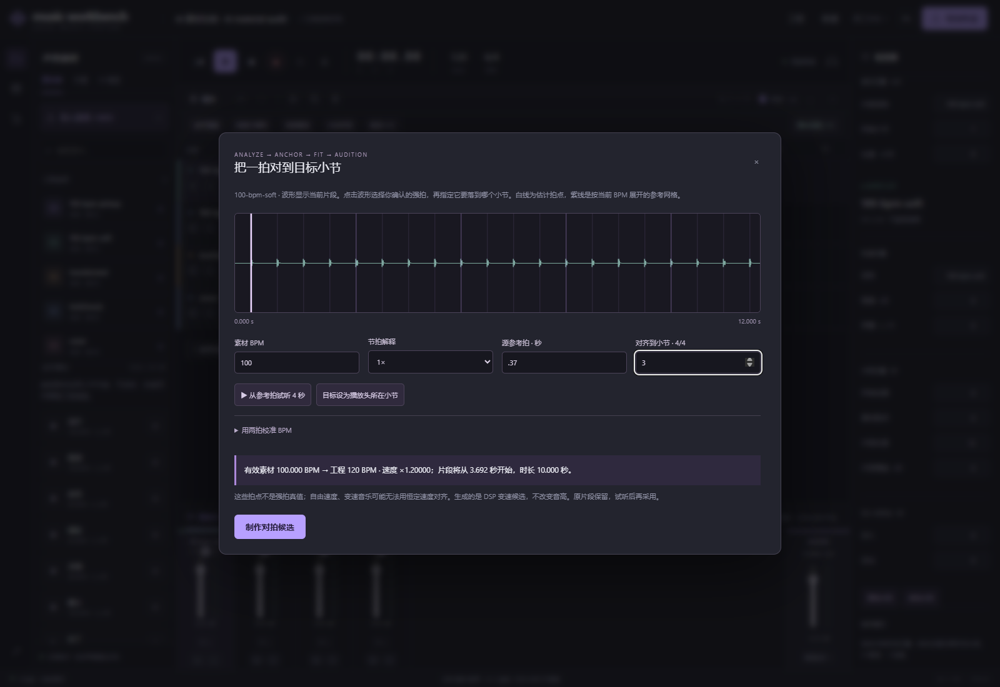
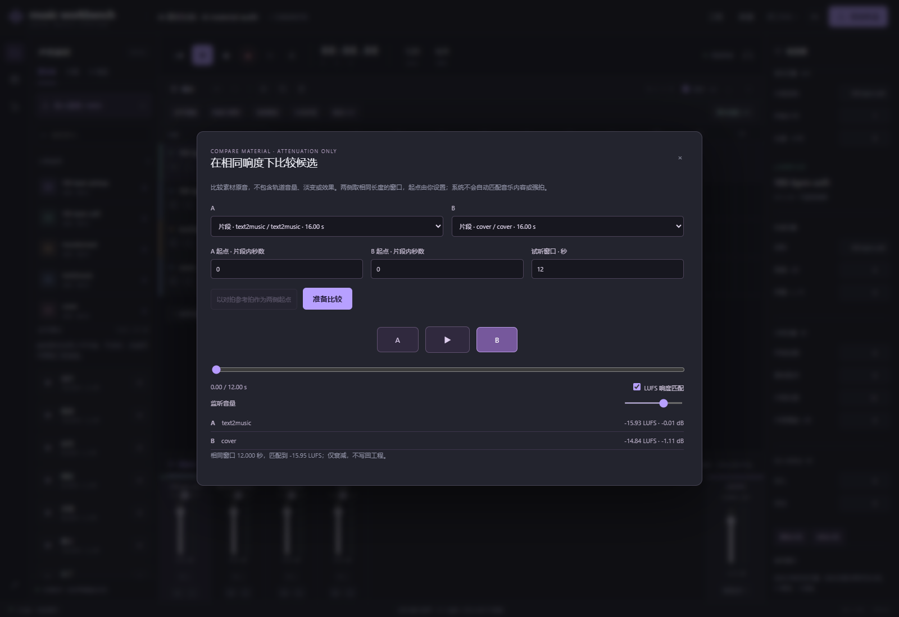

# 素材对拍与候选比较 / Beat fitting and candidate comparison

[文档 / Documentation](README.md) · 适用于 / Applies to dev21

让生成或导入的音频能够进入同一首作品：**分析 → 人工确认参考拍 → 制作适配候选 → 等响度试听 → 采用 / 撤销**。
Tempo analysis and stretching use DSP; this workflow needs no additional neural model.

## 对拍校准 / Beat fit

1. 选中音频片段，打开「素材适配 / AI」运行速度分析。报告内可直接打开「对拍校准」；也可以从时间线上方打开并手填已知 BPM。
   Select audio and run material analysis, then open **Beat fit** from its report or the toolbar.
2. 在当前片段波形中选择你确认的一拍，或输入其**源文件秒数**。白线为估计拍点；紫色参考网格从所选拍展开。
   Choose a beat by ear or enter its **source-file time**. Estimated beats are white; the tempo grid expands from your anchor.
3. 可选择半速 / 倍速解释。若估计不准，展开“两拍校准”，填写较晚一拍及两拍之间的间隔数。例如第 1 拍至第 17 拍为 16 个间隔。
   Resolve half/double-time ambiguity or calibrate from two known beats and their interval count.
4. 指定所选拍要落到第几小节。预览展示速度比、片段起点和时长；参考拍之前的弱起会保留。如果弱起超出工程开头，应移动目标或先裁切。
   Choose its target bar. The preview retains pickup audio and reports timing; an out-of-range pickup requires a later target or trimming.
5. 制作候选。完成后，先在「候选 A/B」试听，再在任务里采用适配结果。当前片段被修改、移除或工程 BPM 改变时不能直接采用旧对拍任务。
   Create a candidate, compare, then adopt. Changes to the source clip or project tempo invalidate replacement.

对拍模型为恒定速度，4/4 小节坐标；**没有自动强拍检测**。BPM 或参考拍错误仍会导致错位。
自由速度、速度变化和模型生成的节奏漂移，可能无法用单一速度比解决。工作台不根据弱调性候选自动移调。
这些结果只是可以继续编辑的 DSP 候选；不会保证保持复杂瞬态或音乐质量。

This fits a single constant tempo on a 4/4 grid, **without automatic downbeat detection**.
Free timing, tempo changes or generated drift may need local timing edits. There is no automatic pitch change
from an uncertain key estimate. Phase-vocoder transients may smear.

## 候选 A/B / Candidate A/B

- 从工程音频片段、已完成的生成草稿、关联处理任务的音频中选择 A 与 B。
  Choose arrangement clips, completed generated drafts or linked processing outputs.
- A/B 起点按**当前片段内的秒数**填写，与对拍面板的源文件秒数不同。每侧可单独移动起点；试听窗口取两侧可用范围的共同长度，0.4–60 秒。
  Offsets here are **seconds within the selected clip**, not source-file time. Windows share the same available duration, 0.4–60 s.
- 原片段与它的对拍候选成对选择时，可一键把两侧起点设到已确认的参考拍。它只对齐起点，不能让不同时速的后续节奏保持同步。
  Pairing an original with its beat-fit task offers an anchor shortcut. It aligns the starting point, not subsequent beats at different tempi.
- 两侧窗口独立测量 integrated LUFS，匹配到较低的共同目标，只衰减，同时给预览保留至少 −1 dBTP 的测量余量。
  Integrated LUFS is measured per window. Matching only attenuates, preserving a measured ceiling at or below −1 dBTP.
- 切换 A/B 继承当前试听时间；切换响度匹配和监听音量不重设位置。后台任务刷新不重新绑定音源。切换采用 HTML 音频播放，不是无缝 crossfade。
  A/B retains the preview time. Matching, monitoring and task refresh do not reload sources; switching is not a seamless crossfade.
- 静音、低于门限、极短窗口或缺少 `pyebur128` 时明确禁用响度匹配，仍可原音比较。不会用 RMS 冒充 LUFS。
  Unmeasurable audio or missing `pyebur128` disables matching explicitly. Raw comparison remains available; RMS is not substituted.
- 比较的是素材原音，**不含片段/轨道增益、淡变、效果器、声像或主输出**。匹配增益只作用于监听，不写回工程，不改变原素材。
  This compares **source audio before arrangement gain, fades, effects, pan and master processing**. Matching never changes the project.
- 预览音频按内容哈希缓存；准备和下载均检查归属及输入/输出哈希。后续编辑工程时必须按新版本重新准备。
  Previews use immutable content-keyed caching with ownership and integrity checks. Project edits require preparing with the new revision.

## 继续编辑 / Continue editing

采用适配素材后，可用 [音量曲线、交叉淡化与局部重绘](volume-and-repaint.md) 组织过渡。变速音乐的局部修正和自动强拍仍在 [路线图](workbench-roadmap.md) 中。

After adoption, use [curves, crossfades and repaint](volume-and-repaint.md) for joins. Local timing edits and learned downbeats remain on the [roadmap](workbench-roadmap.md).
