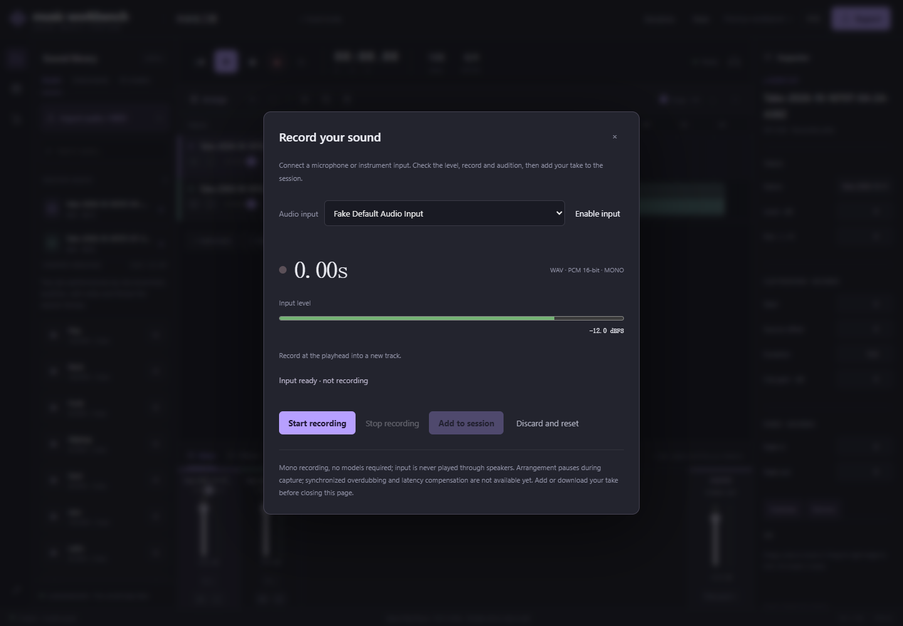

# Local recording

[中文](recording.md)

*Actual browser UI with fake input, using synthetic audio to validate the workflow.*

Open the red ● button, enable input and allow microphone access. Select a microphone or interface input and check its level; lower hardware gain when approaching 0 dBFS.

Starting fixes the session and playhead position. Arrangement playback pauses; input never reaches the speakers. Stop, audition, then download the WAV or explicitly add the take to a new track. Undo removes the track, redo restores it, and the source asset remains. Continue with separation, transcription, mixing and export.

## Format and limits

- AudioWorklet capture at the actual device sample rate; mono PCM 16-bit WAV without lossy encoding. Quantization does not preserve floating-point samples exactly.
- Adoption uses the existing 44.1 kHz stereo asset format, duplicating mono into both channels.
- Stops at the 10-minute session boundary; 32 tracks maximum. Start at or before 599 seconds.
- Browser echo cancellation, noise suppression and automatic gain are requested off; hardware or drivers may still process input.
- Use Chrome or Edge with getUserMedia/AudioWorklet on localhost/127.0.0.1.

## Protecting a take

Input opens only after activation. Stop, cancel, closing the panel or leaving the page releases it. Closing during capture is protected; Discard and reset explicitly deletes the pending take.

Before adoption, audio stays in browser memory. A stopped take survives closing/reopening the panel, but not reliably closing or crashing the page. Add or download it first. Failed saves retain audition, download and retry. Repeating the same take submission cannot add duplicate tracks.

On device failure, delivered PCM remains recoverable; an undelivered audio-thread tail block can be lost, up to roughly 85 ms at 48 kHz.

Synchronized overdubbing, input monitoring, count-in, latency calibration and multichannel recording are not implemented. The timeline position does not compensate for input hardware/browser latency.

[技术验证 / Technical verification](feature-validation.md)。
