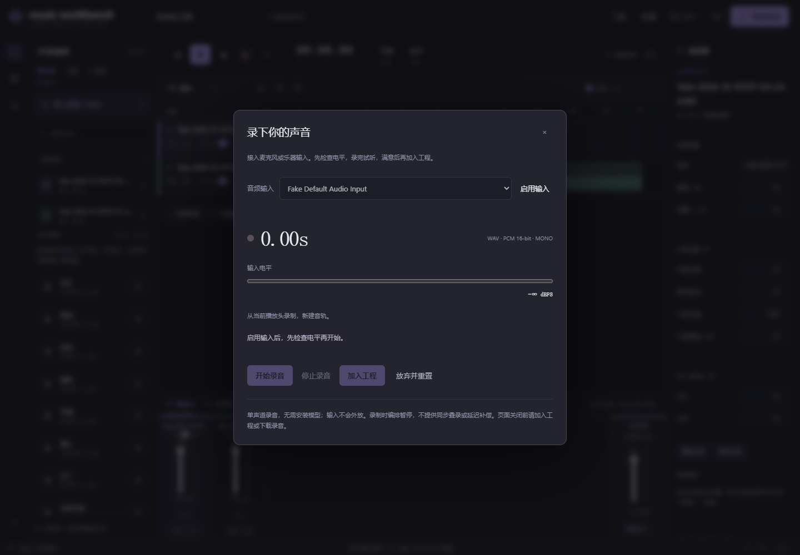

# 本地录音

[English](recording.en.md)

*实机界面，浏览器虚拟输入；验证流程使用合成测试音频。*

从顶部红色 ● 打开录音，点击「启用输入」并允许浏览器访问麦克风。授权后可选择麦克风或声卡输入，观察电平；接近 0 dBFS 时请降低设备增益。

开始录音时固定当前工程和播放头位置，编排暂停，输入不会外放。停止后先试听，可下载 WAV；确认「加入工程」后才新建音轨并保存。一次撤销移除音轨，重做恢复；原素材保留。随后可继续分轨、转写、混音和导出。

## 格式与范围

- AudioWorklet 采集，设备实际采样率、单声道 PCM 16-bit WAV；没有压缩编码，16-bit 量化不等于保留原始浮点样本。
- 入轨后使用既有 44.1 kHz 立体声素材格式，单声道复制到左右声道。
- 最长至工程 10 分钟边界，最多 32 条轨道；播放头需不超过 599 秒。
- 请求关闭浏览器降噪、回声消除和自动增益；设备或驱动仍可能处理输入。
- 请使用本机 localhost/127.0.0.1 上支持 getUserMedia/AudioWorklet 的 Chrome 或 Edge。

## 录音保护

明确启用后才打开麦克风，停止、取消、关闭录音窗口或离开页面时释放。录制时保护窗口关闭；「放弃并重置」明确丢弃当前录音。

确认前，录音在浏览器内存中。停止后可以关闭弹窗再回来试听；关闭或崩溃页面不能保证恢复，请先加入工程或下载 WAV。保存失败保留录音和下载入口；同一 take 重复提交不重复入轨。

设备中断时，已传到页面的 PCM 可恢复；音频线程尚未传回的尾块可能丢失，48 kHz 时最多约 85 ms。

当前不提供同步叠录、输入监听、预备拍、延迟校准或多通道录音。入轨位置是逻辑时间线位置，不代表已补偿声卡/浏览器采集延迟。

## 验证

Node 测试覆盖尾块、精确帧数上限、PCM WAV、取消后迟到授权、设备释放、权限拒绝和设备断开。API 测试覆盖非零入轨位置、重复提交、保存重开、撤销重做与 WAV 导出。

浏览器使用合成 440 Hz WAV 作为虚拟输入，验证完整流程、保存失败后下载/重试与窄屏。此验证不代表真实声卡延迟或真人录音音质评测。
