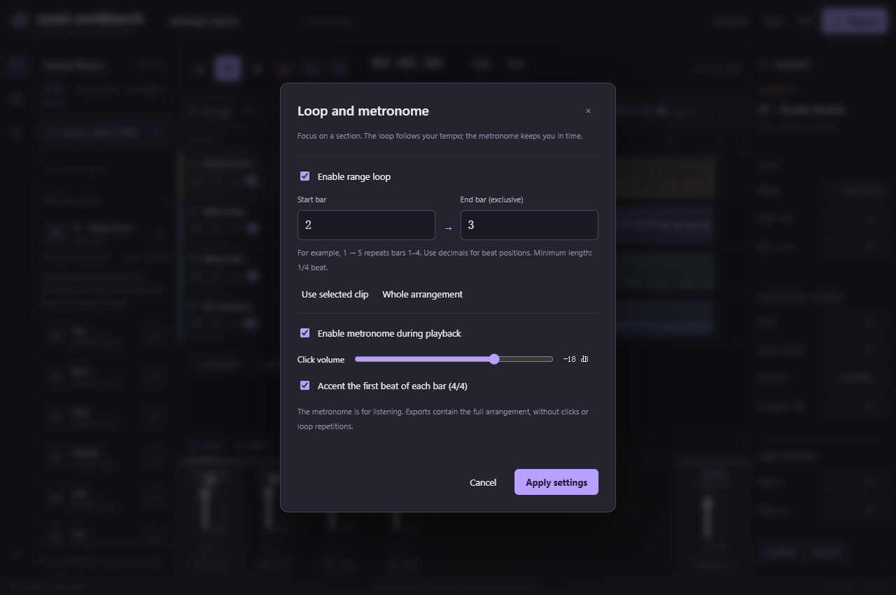

# Loop and metronome

[中文](timing.md) · [Back to Workbench](../README.en.md)

Focus on a drum groove or melody while listening and editing. No models or GPU needed.

[Validation record](timing-validation.md)

1. Open `↻ 1 → 5` in the arrangement toolbar.
2. Set start/end bars, or use the selected-clip/whole-arrangement shortcuts. The end is exclusive: `1 → 5` repeats bars 1–4.
3. Enable the loop and apply. The purple ruler region marks the range. Playback starts at the playhead when inside it; otherwise it starts at the range beginning.
4. Use the transport `↻` to toggle the loop. Toggle the adjacent metronome during playback without reloading audio.

Bars are one-based and allow decimals: `1.25` is bar 1, beat 2. The time signature is fixed at 4/4. Minimum loop length is 1/4 beat, and the end must be within the 10-minute timeline.

Loop positions are saved in beats and follow BPM changes. Audio clips are not automatically time-stretched; MIDI follows tempo. Set click volume from −48 to −6 dB and optionally accent the first beat of each bar. Enable the metronome in an empty session for four bars of practice clicks.

Settings autosave and support undo/redo. Older sessions default to disabled looping/clicks with a 1 → 5 range. Dialog drafts change the session only when applied.

Clicks are for monitoring, separate from master metering/effects and exports. WAV/MIDI export the full arrangement without cropping, repetitions or clicks. Recording still pauses the arrangement; synchronized overdubbing and count-in are not included.

Loops use the audio clock with scheduled sources, shared decoded buffers and persistent effect graphs. Source waveform discontinuities can click at boundaries; adjust the range or clip fades. Effect tails continue across cycles, so loop playback can sound different from a single region of the full export. Browser/system stalls beyond the approximately 1.5-second scheduling window can miss playback; the scheduler catches up to the current clock on recovery. Continuous background playback is not guaranteed.
