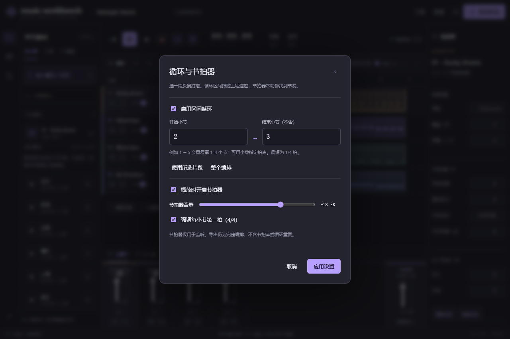

# 循环与节拍器

[English](timing.en.md) · [返回工作台](../README.md)

适合反复听、修改一段鼓点或旋律。无需模型或显卡。

1. 点击编排工具栏的 `↻ 1 → 5` 打开设置。
2. 设置开始与结束小节，或使用「所选片段」「整个编排」快捷设置。结束位置不包含在循环内：`1 → 5` 重复第 1–4 小节。
3. 启用区间循环并应用。标尺上的紫色区域显示范围，播放从区间内的播放头开始；播放头在区间外时从区间起点开始。
4. 顶部 `↻` 可以快速开关循环，旁边的节拍器按钮可以在播放中开关节拍声。

小节从 1 开始，可以输入小数；例如 `1.25` 为第 1 小节第 2 拍。当前拍号固定为 4/4。最短循环 1/4 拍，结束时间不能超过工程 10 分钟上限。

循环位置按拍保存，修改 BPM 后跟随速度。音频片段本身不会自动拉伸，MIDI 则随速度变化。节拍器音量 −48 至 −6 dB，可选择强调每小节第一拍。空工程开启节拍器后，可播放四小节练习节奏。

设置自动保存并支持撤销/重做；旧工程默认关闭循环与节拍器，首次启用的区间为 1 → 5。设置弹窗仅在「应用设置」后修改工程，取消不会改变工程。

节拍器直接用于监听，不进入主输出电平表、效果器或导出。WAV/MIDI 仍导出完整编排，不裁剪为循环区间、不重复，也不包含节拍声。录音仍是先暂停编排再录制；这项更新没有加入同步叠录或预备拍。

循环按音频时钟提前排程，复用音频缓存与效果器。音频来源在循环边界可能存在波形不连续；需要时调整区间或片段淡入淡出。效果器尾音会跨循环延续，循环中的听感可能与完整导出中的单段不同。浏览器或系统阻塞超过排程窗口（约 1.5 秒）仍可能漏播；恢复时会追上当前时钟位置。此功能不保证后台长期无间断运行。
