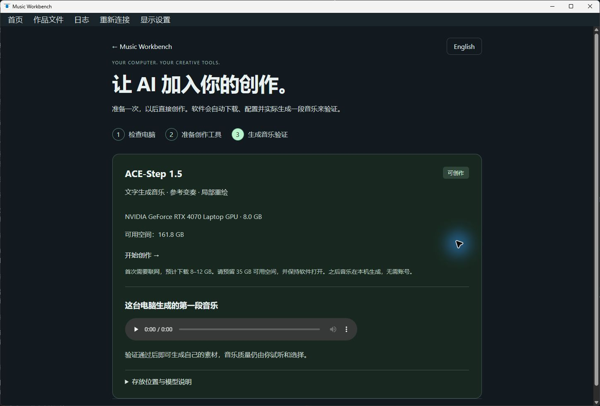

# Windows 安装与 AI 配置验收 / Installer and AI setup validation

2026-10-16 · `0.2.0.dev13` · Windows 11 x64 (26200), RTX 4070 Laptop 8 GB,
NVIDIA 591.74. This records observed behavior, not a clean-VM or listening-quality claim.

| 项目 / Check | 结果 / Observed result |
| --- | --- |
| 基础功能无需系统 Python / No system Python | Bundled CPython 3.12.10 with only System32 on PATH: create example, export WAV, recover port conflict, reuse workspace service. |
| 安装与升级 / Install and upgrade | Per-user dev12 installation; edit/save a four-track example; dev13 opens the same title/project. Subsequent in-place installation retains complete arrangement rows, undo history and audio hashes. |
| 桌面窗口 / Native window | Real WebView2 window, editable project, trusted play action; example clock observed at 10.76 seconds. Exit saves and stops its owned backend. |
| 显示 / Display | Runtime log confirms DPI 96 and per-monitor awareness 2. Windows 10 compatibility, .NET 4.7.2 target, PerMonitorV2 config, zoom reset and diagnostics included. Other display scales and monitor switching were not physically tested. |
| AI 独立环境 / Isolated AI environment | Fresh embedded Python environment created by the installed app with System32-only PATH. No system Python or manually activated environment used by the installer/worker. |
| 暂停、恢复 / Pause and resume | Cancel a real installation; no runtime configuration published. Resume reuses checked files and completes. Cross-window locking, abandoned-job recovery and parent-process loss also have automated coverage. |
| 模型验证 / Model verification | 17 cached checkpoint files, 6,336,686,268 bytes, rechecked against pinned Hub metadata. Source, PyTorch wheel and resolved checkpoint manifest checked. Large weights/wheels were reused from verified caches; this was not a fresh multi-GB network download test. |
| 真推理后启用 / Real inference before ready | Installed setup generates a 12-second sketch: 77.469 s total, 3,148.9 MiB peak Torch allocation; status changes to ready only afterwards. |
| 工作台使用新环境 / Workstation integration | A separate project generation task completes through the managed runtime and current app worker: 45.407 s total, 3,149.3 MiB peak allocation. Source project remains revision 3. |
| 正在运行时安装 / Busy install | Installer refuses while a desktop window is running; no forced process closure. |
| 错误目录 / Invalid destination | Silent installation into a directory containing `.studio.sqlite3` exits nonzero, without a blocking prompt or any database byte change. Interactive validation also explains the problem. |
| 卸载 / Uninstall | Program/registry/shortcuts removed; complete arrangement/history, six audio files and 20 AI artifacts retain hashes. The AI set includes isolated Python, runtime config, test audio and all model files. |

AI output is evidence that inference and playback loading work; it is not a judgment of musical quality or prompt compliance. The app stores models and environments outside its installation directory so an uninstall does not silently erase many GB of user data.

AI 自动配置首批覆盖 ACE-Step，其他模型环境继续使用各自的安装文档。默认需联网准备，基础创作无需模型。开发预览安装器尚未签名；缺少 WebView2 的全新机器分支、不同硬件/缩放比例、受限网络和真正零基础用户仍需扩大验收，不能把本机测试等同于全面兼容性保证。

The first automatic profile covers ACE-Step. Other model environments still use their own guides. Basic creation needs no models. The installer remains an unsigned preview. A clean machine without WebView2, other hardware/display scales, restricted networks and novice-user usability require additional testing.

Build inputs are pinned by `scripts/prepare_installer_tools.py`; the WebView prerequisite's Microsoft signature is checked during packaging. QA used a separate installer AppId and data directory. The original Music Studio model directories were read-only cache sources; existing Workbench project rows were compared before/after and retained exactly.

Implementation references: [Microsoft WinForms DPI configuration](https://learn.microsoft.com/en-us/dotnet/desktop/winforms/high-dpi-support-in-windows-forms?view=netframeworkdesktop-4.8), [CPython embedding](https://docs.python.org/3.12/using/windows.html#the-embeddable-package), [Inno Setup silent event behavior](https://jrsoftware.org/ishelp/topic_scriptevents.htm), [suppressible validation messages](https://jrsoftware.org/ishelp/topic_isxfunc_suppressiblemsgbox.htm).
